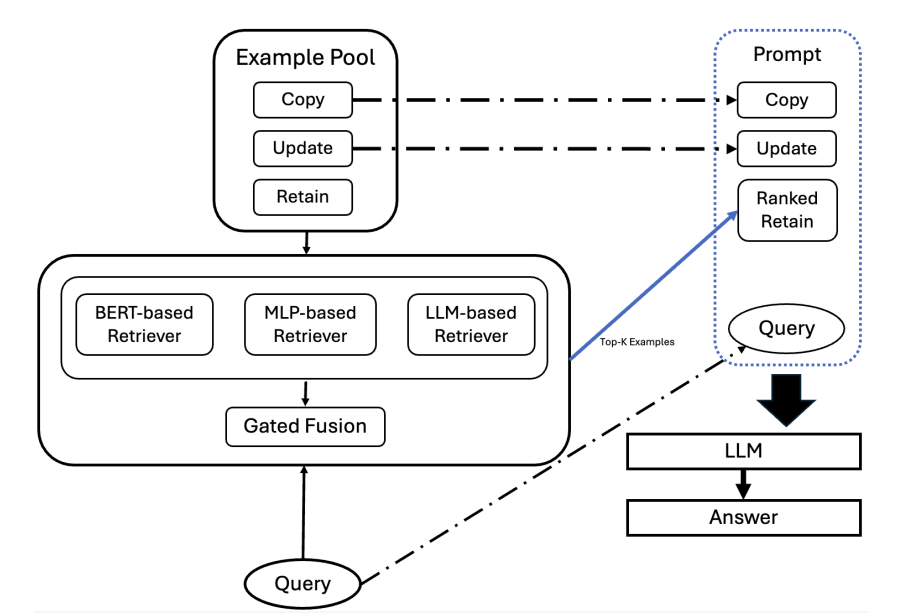

# Confidence-Aware Ranker Ensembles for Robust In-Context Knowledge Editing

This repository contains a lightweight demonstration implementation accompanying:

**Confidence-Aware Ranker Ensembles for Robust In-Context Knowledge Editing**
Anonymous. ACL 2026.

## Paper
Accepted at **ACL 2026 Findings** \
[Read]((https://aclanthology.org/2026.findings-acl.1750/)

## Overview
FWE-IKE improves demonstration selection for In-Context Knowledge Editing (IKE) through a confidence-aware ensemble of multiple retrieval strategies.
<p align="center">
  
</p>

The framework begins with an **example pool** containing candidate demonstrations derived from the IKE corpus. These examples correspond to different editing behaviors, such as *Copy*, *Update*, and *Retain*, and serve as the retrieval database used during inference.

Given a query, three complementary retrievers independently score candidate demonstrations:

- **BERT-based Retriever**: Computes semantic similarity using contextual embeddings from a pretrained transformer encoder.
- **MLP-based Retriever**: Learns retrieval scores from task-specific features and supervision collected during training.
- **LLM-based Retriever**: Uses a large language model to evaluate the relevance of candidate demonstrations to the current editing request.

Because each retriever captures different signals, their outputs are combined through a **confidence-aware gated fusion module**. The fusion model dynamically weights the retrievers according to their confidence and produces a final ranking of demonstrations. 

The highest-ranked examples are then selected and inserted into the prompt. These retrieved demonstrations are combined with the user query and provided to the target language model for IKE.

## Installation
```
pip install -r requirements.txt
```
Requirements:

torch>=2.0
transformers>=4.40
sentence-transformers>=2.7
datasets>=2.18
numpy>=1.24
pandas>=2.0
scikit-learn>=1.3
tqdm>=4.66
accelerate>=0.28
jupyter

## Data

CounterFact:
https://github.com/kmeng01/mend/blob/main/data/counterfact/counterfact.json

Place at:
data/counterfact.json
```
COUNTERFACT_PATH = "data/counterfact.json"
```
IKE retrieval index:
https://github.com/Zce1112zslx/IKE/blob/main/corpus_idx.txt

Place at:
data/corpus_idx.txt
```
IKE_INDEX_PATH = "data/corpus_idx.txt"
```
## Citation

@inproceedings{
anonymous2026confidenceaware,
title={Confidence-Aware Ranker Ensembles for Robust In-Context Knowledge Editing},
author={Anonymous},
booktitle={The 64th Annual Meeting of the Association for Computational Linguistics},
year={2026},
url={https://openreview.net/forum?id=vYUEu8JjvS}
}
